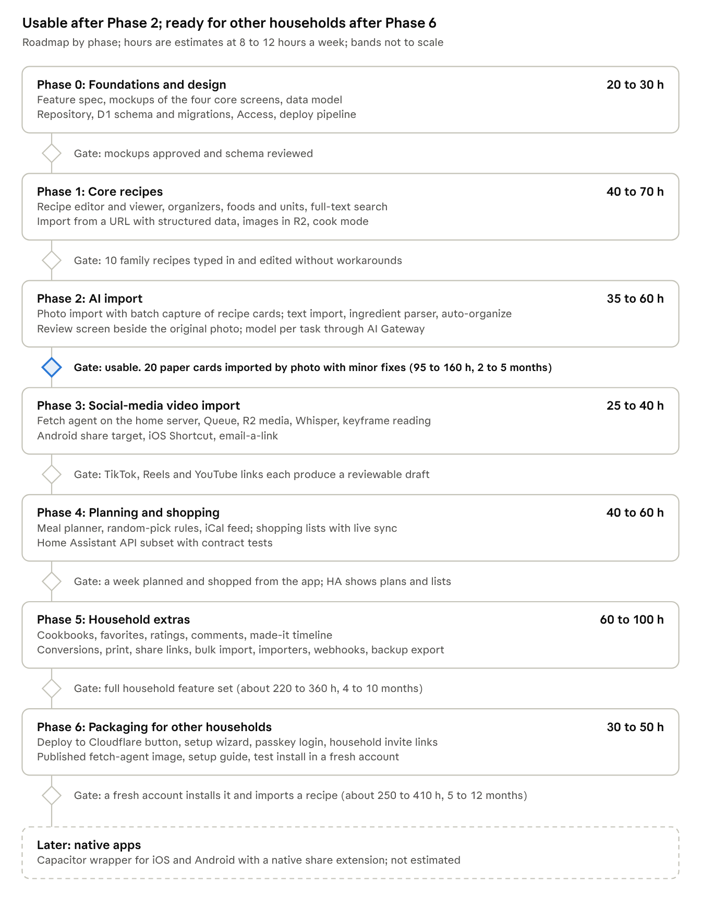

# Cloudflare-Native Recipe App — Build Plan

Nov 22, 2026

## Summary

We will build Maverick Recipeflare (Recipeflare for short), our own recipe app on Cloudflare, matching the Mealie features our household uses, with AI import as a core feature rather than an add-on. Migrating Mealie itself was evaluated and ruled out (next section).

- **Stack:** a TypeScript Worker serving a static frontend and an API, with D1 (SQLite), R2, Durable Objects for live shopping lists, Queues and Workers AI. Our install sits behind Cloudflare Access; other installs use the app's own passkey login.
- **AI import:** one pipeline for web pages, pasted text, photos and social-media videos. Photos of paper recipe cards are the main path, since most of our recipes are hard copies. Every AI result is checked against a recipe schema and shown for review before saving.
- **Video:** the only part that cannot run inside a Worker. The downloader (yt-dlp + ffmpeg) runs in a small fetch agent on the home server, with a Cloudflare Container as the fallback.
- **Sharing:** other households can install their own copy with a Deploy to Cloudflare button. Native iOS and Android apps are a later goal, built by wrapping the same web app.
- **Effort:** usable after Phase 2, about 95–160 hours (2–5 months at 8–12 hours a week). The full household feature set is about 220–360 hours (4–10 months). Packaging for other households adds 30–50 hours.
- **Running cost:** the $5/month Workers Paid plan plus small AI usage, with no server to maintain apart from the optional home-server agent.

## Why not migrate Mealie

Porting Mealie (v3.31.0) to Workers would mean a heavily modified fork that falls behind a fast-moving upstream. Building fresh lets us design around D1, R2 and Workers from the start.

| Blocker | Detail |
| --- | --- |
| Size | FastAPI backend of about 45k lines of Python, 63 tables, 66 migrations, about 290 API routes. Nuxt 4 frontend with 66 pages. |
| Python on Workers | [Python Workers went GA in September 2026](https://blog.cloudflare.com/python-workers-ga/) and run FastAPI. Several of Mealie's native packages have no WebAssembly build: rapidfuzz, curl-cffi, python-ldap, greenlet ([Pyodide package list](https://pyodide.org/en/stable/usage/packages-in-pyodide.html)). Pinned versions of pydantic-core and SQLAlchemy are ahead of what Pyodide ships. |
| Memory | [128 MB per isolate](https://developers.cloudflare.com/workers/platform/limits/) has to hold the Python runtime plus numpy, lxml, Pillow, SQLAlchemy and pydantic. |
| Database | 261 of the 291 route handlers use synchronous SQLAlchemy sessions with rollback. The [D1 SQLAlchemy dialect](https://pypi.org/project/sqlalchemy-cloudflare-d1/) auto-commits every query and has no explicit transactions. |
| Video import | Mealie downloads with yt-dlp and converts audio with ffmpeg, neither of which can run in a Worker. |
| Upstream pace | 1,055 commits in the last 6 months, 85 of them features. Migration files were added or changed 68 times in that period. |
| License | AGPL-3.0. Fine for a personal fork, but a hosted fork must publish its source. |

## Scope

The app covers Mealie's household features in three tiers, plus a fourth tier for sharing it with other households. AI is its own tier, built right after the core recipe features. Mealie's multi-tenant machinery stays out, because each household that installs the app gets its own copy.

| Tier | Feature | Includes | Phase |
| --- | --- | --- | --- |
| 1 Core | Recipes | Title, yield, times, structured ingredients (quantity, unit, food, note, sections), instruction sections, notes, nutrition, images, attachments, original card photo | 1 |
| 1 Core | Organizers | Categories, tags, tools; foods, units and labels (labels double as store aisles) | 1 |
| 1 Core | Search and filters | Full-text search; filter by tag, category, tool or food; sort | 1 |
| 1 Core | Import from a URL | Reads the schema.org Recipe data most recipe sites publish | 1 |
| 1 Core | Cook mode | Screen stays on, step and ingredient checkboxes, scaling, works offline | 1 |
| 1 Core | Meal planner | Calendar by meal type, notes, random-pick rules by tag or category, iCal feed | 4 |
| 1 Core | Shopping lists | Add a recipe with scaling, merge duplicates, sort by aisle, live sync between phones | 4 |
| 1 Core | Home Assistant API | Mealie-compatible subset so HA's Mealie integration works unchanged | 4 |
| 2 AI | Import from photos | Main path for our paper recipes: photograph a stack of cards in one session, front and back paired, original photo kept | 2 |
| 2 AI | Import from text or a page | Pasted text, page HTML, or a URL with no structured data | 2 |
| 2 AI | Ingredient parser | Rule-based first, AI fallback, matched to our food and unit lists | 2 |
| 2 AI | Auto-organize | Suggests tags, categories and tools the recipe itself mentions | 2 |
| 2 AI | Step details | Links ingredients and stated times to each instruction step | 2 |
| 2 AI | Translate on import | Converts a foreign-language recipe on the way in | 2 |
| 2 AI | Social-media video import | TikTok, Instagram Reels, YouTube and Shorts, Facebook | 3 |
| 2 AI | Share to the app | Android share sheet, iOS Shortcut, email-a-link | 3 |
| 3 Extras | Collections | Cookbooks (saved filters), favorites, ratings, comments | 5 |
| 3 Extras | Made-it timeline | Dated entries with a photo and notes | 5 |
| 3 Extras | Conversions and output | US/metric conversion, print view, public share links | 5 |
| 3 Extras | Bulk import and importers | List of URLs; Mealie export, Paprika, schema.org JSON (for other households) | 5 |
| 3 Extras | Webhooks and backup | Meal-plan webhooks to Home Assistant; JSON + images export | 5 |
| 4 Sharing | Deploy button | Installs a full copy into another person's Cloudflare account | 6 |
| 4 Sharing | Built-in login | Passkeys, household members added by invite link; Access optional | 6 |
| 4 Sharing | Setup wizard | Protected first run, optional fetch agent, email and custom-domain steps | 6 |
| 4 Sharing | Native apps | iOS and Android apps wrapping the same web app, with a native share sheet | Later |

**Out of scope:** several groups or households in one install, open sign-up, user admin beyond household members, LDAP and OIDC login (Access or passkeys cover login), 42-language translation, admin maintenance pages, reports, data seeders and custom recipe actions.

## AI features

The app reproduces Mealie's AI import pipeline and runs it on Workers AI by default, with stronger outside models available per task through AI Gateway. Every import, whatever its source, goes through the same steps and ends on a review screen before anything is saved.

**What Mealie does today** ([source](https://github.com/mealie-recipes/mealie/tree/mealie-next/mealie/services/openai)): one OpenAI-compatible AI provider setting drives a staged import. It gathers the source (web page, structured data, images or a video transcript), builds a schema.org recipe, adds per-step details, assigns tags and categories, and can translate. Video import downloads audio and subtitles with yt-dlp, transcribes them, and treats the transcript as the source for steps and the caption as the source for ingredients and title. Its prompts forbid inventing anything and return an empty recipe when the source is too thin.

**Our pipeline** keeps those rules and stages:

1. **Gather:** page structured data and text, the post caption, the transcript or subtitles, and text read from photos or video frames. The source URL and thumbnail are kept with the recipe.
2. **Build:** a model in [JSON mode](https://developers.cloudflare.com/workers-ai/features/json-mode/) fills our recipe schema. It must not invent anything, and returns empty when the source is too thin.
3. **Validate:** the output is checked against the schema in code. Missing ingredients or steps are flagged for review rather than guessed.
4. **Parse ingredients:** rules handle common lines first, then the model handles the rest. Results are matched to our food and unit lists.
5. **Add step details:** links ingredients and stated times to each step.
6. **Organize:** suggests only tags, categories and tools the recipe itself mentions, limited to existing ones by default.
7. **Translate:** optional, on the way in.
8. **Review:** the cook confirms or edits before saving. Rejections are logged to improve prompts.

| Task | Default on Workers AI | Upgrade through AI Gateway |
| --- | --- | --- |
| Build a recipe from text | A text model in JSON mode | A frontier model through the [OpenAI-compatible endpoint](https://developers.cloudflare.com/ai-gateway/usage/chat-completion/) |
| Transcribe speech | [Whisper large v3 turbo](https://developers.cloudflare.com/workers-ai/models/whisper-large-v3-turbo/) | Same, or a provider's transcription model |
| Read photos and video frames | A vision model such as [Moondream 3.1](https://developers.cloudflare.com/workers-ai/models/moondream3.1-9B-A2B/) or [Llama 4 Scout](https://developers.cloudflare.com/workers-ai/models/llama-4-scout-17b-16e-instruct/) | A frontier vision model |
| Parse ingredient lines | Rules, then a small text model | Rarely needed |

The model for each task is a setting, as Mealie's provider setting is. AI Gateway adds request logs, caching, spend limits and fallback between providers.

## Social-media video import

A shared video link becomes text (caption, subtitles or transcript, plus on-screen text), and that text goes through the normal AI pipeline. Only the download step runs outside Workers, because it needs yt-dlp and ffmpeg.

![Video import flow. A shared link reaches the import Worker, which expands short links, skips duplicates and records an import job. If the caption has the recipe, it goes straight to the AI pipeline. Otherwise the job waits on a Queue for the fetch agent on the home server, which uses yt-dlp and ffmpeg and uploads audio, subtitles, caption and keyframes to R2 (deleted after 7 days). A Workflow extracts text from subtitles or a Whisper transcript and reads on-screen text with a vision model, then the AI pipeline builds a draft for review with the source link, thumbnail and transcript kept.](images/video-import-flow.png)

Posts whose caption carries the full recipe never reach the agent. Only the rest are downloaded, on the home server.

### Getting a link in

- **Android:** the app installs as a PWA and appears in the share sheet through the [Web Share Target API](https://developer.chrome.com/docs/capabilities/web-apis/web-share-target).
- **iPhone:** Safari does not support Web Share Target ([WebKit bug 194593](https://bugs.webkit.org/show_bug.cgi?id=194593), open since 2019). Instead, an Apple Shortcut in the share sheet posts the link to the app with a Cloudflare Access service token.
- **Any device:** email the link to a recipes address. Email Routing hands the message to a Worker, which pulls out the link.
- **In the app:** paste the link into the import box.

### Steps

1. **Accept:** the Worker expands short links, checks the source URL against existing recipes, records an import job and replies at once. The app shows the job as in progress.
2. **Try the caption first:** many posts carry the full recipe in the caption. TikTok's public [oEmbed endpoint](https://developers.tiktok.com/doc/embed-videos) returns the caption and thumbnail without a download. If the caption has both ingredients and steps, the recipe is built from it and the download is skipped.
3. **Queue the download:** otherwise the job goes on a Queue.
4. **Fetch agent:** a small service pulls jobs through a [Queues pull consumer](https://developers.cloudflare.com/queues/configuration/pull-consumers/). It needs outbound HTTPS only and no open ports. It runs yt-dlp for low-bitrate mono audio, subtitles, caption and thumbnail, and ffmpeg for 4–8 keyframes. It uploads them to R2 and acknowledges the job.
5. **Extract:** a Workflow uses subtitles when present and Whisper otherwise, reads on-screen text from the keyframes with a vision model, and runs the pipeline. As in Mealie, the transcript leads for steps and the caption leads for ingredients and title. Conflicts are flagged for review.
6. **Review:** the recipe is saved as a draft with its source link, thumbnail and transcript attached.
7. **Clean up:** an R2 lifecycle rule deletes audio and frames after 7 days. The transcript text stays with the recipe.

### Where the downloader runs

The home server is the recommended host because it has a residential IP. Video sites block yt-dlp from datacenter IPs with "Sign in to confirm you're not a bot" even when valid cookies are supplied ([example](https://dev.to/osovsky/i-was-building-a-cloud-video-service-youtube-turned-me-into-an-ip-trafficker-1l9o), [yt-dlp issue 10128](https://github.com/yt-dlp/yt-dlp/issues/10128)).

| Option | Strengths | Weaknesses |
| --- | --- | --- |
| Home server agent (recommended) | Residential IP, no extra cost, outbound-only connection | Jobs wait in the queue while the server is down |
| [Cloudflare Container](https://developers.cloudflare.com/containers/pricing/) | All on Cloudflare; scales to zero; billed per 10 ms of activity | Datacenter IP, so blocks are likely even with cookies |
| OVH VPS | Already online all the time | Datacenter IP, same blocking risk |
| Paid extraction service | Nothing to maintain | Charged per recipe; a third party sees every link |

The agent is one container image with a pinned job runner and a nightly yt-dlp update, since sites change often and yt-dlp releases fixes quickly.

### When it fails

- **Download blocked, private or login-only:** build from the caption alone and say so on the review screen. With no caption either, save a link-only bookmark with the thumbnail.
- **No recipe in the video:** the model returns empty, and the import becomes a link-only bookmark rather than an invented recipe.
- **Agent offline:** the job stays queued and the app shows "waiting for the fetch agent".
- **Instagram login walls:** an optional cookies file from a dedicated account, as Mealie supports. That account may get flagged, so this is a decision (see Risks).

Downloading from these platforms may conflict with their terms of service. The design keeps only derived text and a thumbnail, deletes media within a week, and is for household use.

## Architecture on Cloudflare

One Worker serves the frontend and the API, and everything stateful lives in Cloudflare storage. The only piece off Cloudflare is the optional fetch agent for video downloads.

![Architecture. Family devices (installed PWA) and the iOS Shortcut and email path go through Cloudflare Access to one App Worker (TypeScript, Hono) that serves the PWA and the API. Home Assistant reaches the Worker on its own hostname with an API token from the home IP, skipping Access. The Worker uses D1 with FTS5, Durable Objects for live shopping-list sync, R2 with the Images binding, Queues and Workflows for import jobs, Workers AI with AI Gateway, and Cron with Email Routing. The fetch agent runs outside Cloudflare on the home server (yt-dlp and ffmpeg in Docker), pulls jobs from the Queue and uploads media to R2.](images/architecture.png)

Every request passes Cloudflare Access except Home Assistant's, which uses its own hostname and an app token. The fetch agent reaches in only to pull jobs and upload media.

| Component | Cloudflare product | Role |
| --- | --- | --- |
| Frontend | Workers Static Assets | Installable PWA: recipe browser, editor, cook mode, planner, lists |
| API | Worker (Hono, TypeScript) | REST API, including the Home Assistant-compatible subset |
| Database | D1 with Drizzle ORM | Recipes, ingredients, foods and units, plans, lists, import jobs |
| Search | D1 FTS5 | Full-text index over title, description, ingredients and tags |
| Live lists | Durable Object per shopping list | WebSocket sync between phones; writes through to D1 |
| Files | R2 | Recipe images and attachments; import media with a 7-day lifecycle |
| Images | Images binding | Resize and convert uploads to WebP thumbnails |
| Jobs | Queues and Workflows | URL, photo, bulk and video imports with retries |
| AI | Workers AI and AI Gateway | Model per task, logs, caching, spend limits |
| Scheduled | Cron Triggers | Cleanup, nightly JSON + images export to R2 |
| Login | Cloudflare Access | Our install: family accounts by email. Other installs: optional, in front of built-in passkey login |
| Email in | Email Routing | Recipes address that accepts links |
| Fetch agent | Home server (Docker) | yt-dlp and ffmpeg; pulls jobs from a Queue, uploads to R2 |

### Data model

- **Shape:** our own schema, modeled on schema.org Recipe plus Mealie's ideas of foods, units and labels. No Mealie tables or code are copied.
- **Atomic saves:** IDs are generated in the Worker, so a recipe and its ingredients, steps and tags save in one D1 batch. D1 runs a batch as one SQL transaction and [rolls the whole sequence back](https://developers.cloudflare.com/d1/worker-api/d1-database/) if any statement fails.
- **Search:** an FTS5 table kept in sync by triggers, in place of Mealie's simple SQLite search.
- **Tenancy:** one D1 database for the household. If this becomes a product, each household gets its own D1 database or Durable Object.

### Login

Our install keeps Cloudflare Access in front, as NoteFlare does. The Worker validates the Access JWT and maps the email address to a household member. Installs made with the Deploy button cannot count on Access, so the app also has its own login: a passkey per household member, added by invite link from the owner.

Non-browser clients get their own credentials: an Access service token or a device token for the iOS Shortcut, and an app-issued API token for Home Assistant (next section).

### Installs for other households

The [Deploy to Cloudflare button](https://developers.cloudflare.com/workers/platform/deploy-buttons/) copies our public repository into the installer's GitHub or GitLab account, provisions resources, and deploys through Workers Builds.

- **Provisioned automatically:** D1, R2, KV, Durable Objects, Workers AI and Queues, with the new IDs written into the installer's Wrangler config.
- **Not on that list:** Workflows and Containers. Both need a test in a fresh account before we rely on them, and import jobs need a Queue-only fallback.
- **Migrations:** D1 migrations do not run on their own. Our `deploy` script runs them by binding name, and they only ever move forward.
- **Secure first run:** a fresh install sits on a public workers.dev address. The button asks for a setup secret, and every page shows the setup screen until the owner enters it and registers a passkey.
- **Video for other installs:** the fetch agent is a published Docker image they can run at home. Without it, video import falls back to captions only; the Container is an opt-in on Workers Paid.
- **Manual, optional steps:** Access, the email-in address and a custom domain, covered in a setup guide.
- **Updates:** installers' copies are clones and update when they pull from our repository. The app shows a notice when a newer release exists.

### Path to native apps

The frontend stays a static single-page app that talks only to the JSON API, with the server address as a setting. A native app is then mainly a wrapper plus a sign-in screen that asks for the server address, as Home Assistant's companion app does.

- **Android:** Google Play accepts a PWA packaged as a [Trusted Web Activity](https://www.mobiloud.com/blog/publishing-pwa-app-store), the quickest route.
- **iOS:** the App Store accepts only native apps, so Capacitor wraps the web app. Receiving shared links on iOS needs a [share extension](https://capawesome.io/docs/sdks/capacitor/share-target/), which also closes the iPhone share-sheet gap in the video section.
- **Store review:** Apple rejects thin web wrappers, so the iOS app needs native features such as the share extension, camera capture and offline use.
- **Timing:** after Phase 6 and not estimated yet. Passkey login and token auth from Phase 6 are what make a native client possible.

## Home Assistant compatibility

The app will answer the 30 Mealie API paths that Home Assistant's client library calls, so HA's Mealie integration works without a custom integration. The client is [aiomealie](https://github.com/joostlek/python-mealie) (MIT license), which sends a Bearer token and reads the server version from `/api/app/about`.

| Area | Paths (all under `/api`) |
| --- | --- |
| App and user | `app/about`, `app/about/startup-info`, `app/about/theme`, `users/self`, `groups/self`, `households/self`, `households/statistics` |
| Recipes | `recipes`, `recipes/{slug}`, `recipes/create/url` |
| Organizers and data | `organizers/categories`, `organizers/tags`, `organizers/tools`, `foods`, `units`, `parser/ingredient` |
| Meal plans | `households/mealplans`, `households/mealplans/{id}`, `households/mealplans/today`, `households/mealplans/random` |
| Shopping | `households/shopping/lists`, `households/shopping/lists/{id}`, `households/shopping/lists/{id}/recipe/{recipe_id}`, the matching `/delete` path, `households/shopping/items`, `households/shopping/items/{id}` |
| Favorites and ratings | `users/self/favorites`, `users/{user_id}/favorites/{slug}`, `users/{user_id}/ratings/{slug}` |

- **Contract tests:** aiomealie's response models run against our API in CI, so a shape change fails the build before HA breaks.
- **Access:** HA cannot send Access credentials. The HA paths use a separate hostname with an Access bypass limited to the home IP, and the Worker still requires the app-issued token.
- **What HA gets:** meal plans as calendar entities and shopping lists as to-do lists, plus HA actions to import a URL, set a random meal and fetch recipes.

## Roadmap

Seven phases take the app from mockups to a copy other households can install themselves. The family can start using it after Phase 2, about 95–160 hours in (2–5 months at 8–12 hours a week). Native apps come after Phase 6.

| Phase | Hours | Includes | Gate |
| --- | --- | --- | --- |
| 0 Foundations and design | 20–30 | Feature spec, mockups of the four core screens, data model; repository, D1 schema and migrations, Access, deploy pipeline | Mockups approved and schema reviewed |
| 1 Core recipes | 40–70 | Recipe editor and viewer, organizers, foods and units, full-text search; import from a URL with structured data, images in R2, cook mode | 10 family recipes typed in and edited without workarounds |
| 2 AI import | 35–60 | Photo import with batch capture of recipe cards; text import, ingredient parser, auto-organize; review screen beside the original photo; model per task through AI Gateway | **Usable:** 20 paper cards imported by photo with minor fixes (95–160 h in total, 2–5 months) |
| 3 Social-media video import | 25–40 | Fetch agent on the home server, Queue, R2 media, Whisper, keyframe reading; Android share target, iOS Shortcut, email-a-link | TikTok, Reels and YouTube links each produce a reviewable draft |
| 4 Planning and shopping | 40–60 | Meal planner, random-pick rules, iCal feed; shopping lists with live sync; Home Assistant API subset with contract tests | A week planned and shopped from the app; HA shows plans and lists |
| 5 Household extras | 60–100 | Cookbooks, favorites, ratings, comments, made-it timeline; conversions, print, share links, bulk import, importers, webhooks, backup export | Full household feature set (220–360 h in total, 4–10 months) |
| 6 Packaging for other households | 30–50 | Deploy to Cloudflare button, setup wizard, passkey login, household invite links; published fetch-agent image, setup guide, test install in a fresh account | A fresh account installs it and imports a recipe (250–410 h in total, 5–12 months) |
| Later: native apps | Not estimated | Capacitor wrapper for iOS and Android with a native share extension | None yet |

Hours are estimates at 8 to 12 hours a week.

A phase ends when its gate passes, not on a date. AI and video import come before planning and shopping because they set this app apart and need real links to tune. Estimates assume Claude Code does most of the typing.

## Running costs

Expected cost is about $5 a month, the Workers Paid plan. At household scale, AI imports should fit inside Workers AI's free daily allocation. Other households pay for their own installs on their own accounts.

| Item | Cost | Basis |
| --- | --- | --- |
| Workers Paid plan | $5.00/month | Includes monthly Container usage ([pricing](https://developers.cloudflare.com/containers/pricing/)) |
| Workers AI allocation | 10,000 Neurons/day free; $0.011 per 1,000 beyond | [Workers AI pricing](https://developers.cloudflare.com/workers-ai/platform/pricing/) |
| Transcription | $0.0005 per audio minute (about 47 Neurons) | Whisper large v3 turbo, same page |
| Building one recipe | About $0.0016 (about 145 Neurons) | Estimate: 3,000 input + 1,000 output tokens on Gemma 3 12B ($0.345 and $0.556 per million tokens) |
| Container downloader (if used) | About $0 | A 60-second job on the basic type uses 1/1,500 of the included memory and vCPU |
| Frontier models through AI Gateway (optional) | Per use | Unified Billing credits or our own provider keys |

At about 145 Neurons per recipe plus 47 per minute of audio, the free allocation covers roughly 50 one-minute video imports a day. Storage costs for D1, R2 and Queues still need checking against their pricing pages once real usage is known, but they are expected to stay within included amounts.

For other installs, the setup guide will recommend Workers Paid. The free plan allows [10 ms of CPU per request](https://developers.cloudflare.com/workers/platform/limits/), which is untested for this app, and Containers need the paid plan.

## Decisions and risks

All nine decisions were made on 22 Nov 2026, including the name and the license for our own code. None are open.

| Decision | Choice | What it changes |
| --- | --- | --- |
| Scope | Household app that other households can install with a Deploy to Cloudflare button | One household per install; adds Phase 6 and built-in passkey login |
| Frontend | Vite single-page PWA, mobile first, in the framework the mockups use | Can be wrapped as Android and iOS apps later |
| Existing recipes | Mostly paper, entered by us | Photo import of cards becomes the main importer; no digital importer needed for our install |
| Downloader host | Home server agent, Container as fallback | Other installs run the agent optionally, or get caption-only video import |
| Instagram cookies | Cookies from a dedicated account | The agent reads a cookies file; that account may get flagged |
| Default AI models | Workers AI first, compared on 20 real imports | Handwritten cards are part of the 20, since they are the hardest case |
| Home Assistant API | Phase 4 | Contract tests land with it |
| Name | Maverick Recipeflare, Recipeflare for short | Used for the repository, Worker and app; the word Cloudflare and its flare shapes stay out of the name and icon |
| License | AGPL-3.0-only, matching Mealie | LICENSE file from the first public commit; anyone running a modified copy as a service must offer its source; covers the fetch-agent image too |

| Risk | Effect | Mitigation |
| --- | --- | --- |
| Platforms block or change video downloads | Video import fails until yt-dlp catches up | Caption-first path, nightly yt-dlp update, link-only fallback |
| AI invents quantities or steps | Wrong recipes | Prompts that forbid inventing, schema validation, review screen, transcript kept |
| Handwriting is hard to read | Card imports need heavy fixing | Original photo shown beside the draft; a frontier vision model for handwritten cards if Workers AI falls short |
| A fresh install is public before setup | A stranger could claim someone's install | Setup secret from the Deploy button; setup screen until the owner registers a passkey |
| Workflows or Containers fail through the Deploy button | Video import breaks on other installs | Test in a fresh account; Queue-only fallback |
| Installers' copies don't update themselves | Old installs drift from Home Assistant and import fixes | Forward-only migrations on deploy; in-app notice of new releases |
| Recipe sites block requests from Workers | URL import fails for some sites | [Browser Run](https://developers.cloudflare.com/browser-run/) fallback, paste-the-page option |
| Workers AI models change (Whisper turbo is beta) | An import step stops working | Model per task is a setting; AI Gateway fallback to another provider |
| Home server offline | Video imports wait | Jobs stay queued; Container fallback |
| Scope creep toward full Mealie parity | Nothing ships | Phase gates; out-of-scope list |
| Solo pace of 8–12 hours a week | Long gaps stall progress | Usable after Phase 2; keep the current recipe setup until then |
| aiomealie changes its models | HA integration breaks | Contract tests pinned to an aiomealie version |

## Licensing and naming

We copy Mealie's features, not its code. Mealie is AGPL-3.0, so copying its source, Vue components, prompt text or translation files would make our app a derivative under that license. This is general guidance, not legal advice.

- **Build from the feature list:** this doc's scope table, not Mealie's source. Prompts are written fresh from the rules described in the AI section.
- **Name and branding:** Maverick Recipeflare, with a logo that stays clear of Cloudflare's flare shapes. The HA-compatible API copies endpoint paths and response shapes only, for interoperability.
- **Dependencies:** aiomealie (MIT) is used only in tests. yt-dlp and ffmpeg run as separate tools inside the fetch agent and are not part of the app's code.

Our own code is licensed AGPL-3.0-only, the same license as Mealie. Anyone who runs a modified copy as a network service must offer that copy's source to its users. Because the licenses match, reusing a piece of Mealie's code would now be allowed if its copyright notices are kept, but the plan still writes fresh code.

## Sources

**Opened and read**

- [Mealie repository, mealie-next branch](https://github.com/mealie-recipes/mealie/tree/mealie-next) (cloned 22 Nov 2026, v3.31.0)
- [aiomealie, Home Assistant's Mealie client](https://github.com/joostlek/python-mealie)
- [Python Workers are generally available](https://blog.cloudflare.com/python-workers-ga/)
- [Packages in Pyodide](https://pyodide.org/en/stable/usage/packages-in-pyodide.html)
- [Workers limits](https://developers.cloudflare.com/workers/platform/limits/)
- [sqlalchemy-cloudflare-d1](https://pypi.org/project/sqlalchemy-cloudflare-d1/)
- [D1 Database Worker API (batch transactions)](https://developers.cloudflare.com/d1/worker-api/d1-database/)
- [Workers AI pricing](https://developers.cloudflare.com/workers-ai/platform/pricing/)
- [Containers pricing](https://developers.cloudflare.com/containers/pricing/)
- [Deploy to Cloudflare buttons](https://developers.cloudflare.com/workers/platform/deploy-buttons/)

**From search results**

- [Workers AI JSON mode](https://developers.cloudflare.com/workers-ai/features/json-mode/)
- [Whisper large v3 turbo](https://developers.cloudflare.com/workers-ai/models/whisper-large-v3-turbo/)
- [Moondream 3.1 on Workers AI](https://developers.cloudflare.com/workers-ai/models/moondream3.1-9B-A2B/)
- [AI Gateway OpenAI-compatible endpoint](https://developers.cloudflare.com/ai-gateway/usage/chat-completion/)
- [Queues pull consumers](https://developers.cloudflare.com/queues/configuration/pull-consumers/)
- [D1 SQL statements and FTS5](https://developers.cloudflare.com/d1/reference/sql-statements)
- [Web Share Target API](https://developer.chrome.com/docs/capabilities/web-apis/web-share-target)
- [WebKit bug 194593: Web Share Target](https://bugs.webkit.org/show_bug.cgi?id=194593)
- [TikTok oEmbed](https://developers.tiktok.com/doc/embed-videos)
- [yt-dlp issue 10128: datacenter IP blocking](https://github.com/yt-dlp/yt-dlp/issues/10128)
- [Mealie 3.13 release: social media video import](https://newreleases.io/project/github/mealie-recipes/mealie/release/v3.13.0)
- [Browser Run](https://developers.cloudflare.com/browser-run/)
- [Publishing a PWA to the App Store and Google Play](https://www.mobiloud.com/blog/publishing-pwa-app-store)
- [Capacitor Share Target plugin](https://capawesome.io/docs/sdks/capacitor/share-target/)
- [Flambae on the App Store](https://apps.apple.com/ca/app/flambae/id6746421410)
- [Heirloom Kitchen on the App Store](https://apps.apple.com/us/app/-/id6757515427)
